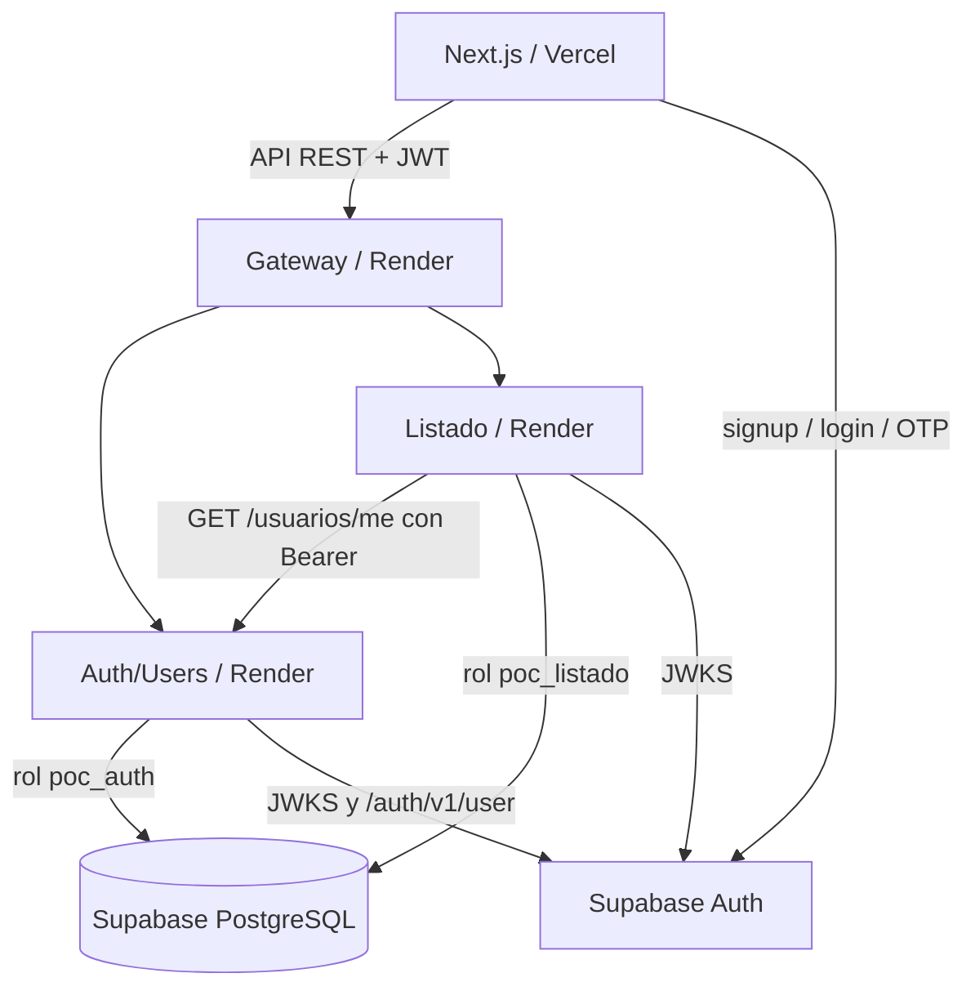

# Roomies · PoC de arquitectura y despliegue

**PoC independiente del repositorio oficial de TI2.** No sustituye su backend, ni supone que una integración o despliegue ya se haya realizado. El objetivo es experimentar DEP-01 y reunir evidencia real para DEP-02.

## Componentes

- `web/`: Next.js, React y TypeScript. Cliente Supabase Auth, listado y creación de publicaciones.
- `backend/api-gateway/`: FastAPI enrutando solicitudes HTTP a ambos servicios, con `/health` y `/ready`.
- `backend/services/auth-users-service/`: valida JWT de Supabase con JWKS, consulta correo verificado desde Supabase Auth, gestiona perfiles mediante SQLAlchemy.
- `backend/services/listado-applications-service/`: valida JWT, crea/lista publicaciones, consulta `/usuarios/me` de Auth/Users vía HTTP (sin SQL cruzado).
- `infra/database/`: PostgreSQL local con dos schemas/roles; script equivalente para Supabase.

## Diagrama de flujo de la PoC



La PoC utiliza **dos** servicios, no los cinco de producción. Incluye solo una publicación *Compartida*, sin políticas de cupos de arriendos activos ni los demás bounded contexts.

## Requisitos para el entorno local

- Git, Docker Desktop (WSL 2) y Node.js 20.9+ (preferentemente Node LTS actual). Python 3.12 para trabajar localmente sin Docker.
- **Proyecto Supabase separado, de pruebas, y con firma JWT asimétrica ES256/RS256.** No utilizar Supabase ni la base real del equipo. En el backend los tokens HS256 no están habilitados.
- Correo de prueba que puedas confirmar, sin compartir su contraseña en GitHub.

## Paso 1. Configurar Supabase de pruebas

1. Crear proyecto en <https://supabase.com/dashboard>.
2. En **Authentication → Sign In / Providers**, habilitar Email y exigir confirmación de correo.
3. En **Authentication → Email Templates → Confirm sign up**, incluir `{{ .Token }}` en el cuerpo del correo para recibir un OTP de 6 dígitos. Puedes conservar el enlace de confirmación como alternativa.
4. Revisar **Authentication → JWT Signing Keys**: debe estar activa una clave asimétrica ES256 o RS256. Si el proyecto está en HS256, migrar/rotar según documentación antes de probar el backend.
5. Copiar la Project URL y la clave **publishable** (no la secret/service_role).
6. Crear dos contraseñas nuevas, diferentes, aleatorias y largas. Abrir `infra/database/002_supabase_setup.sql`, reemplazar `TEMP_PASSWORD_AUTH` y `TEMP_PASSWORD_LISTADO` **solo dentro del SQL Editor**, y ejecutar las sentencias. No guardar la versión con secretos en Git.
7. Copiar desde **Connect → Session Pooler** las conexiones de base de datos correspondientes a los roles `poc_auth` y `poc_listado`. En el pooler, el usuario suele tener la forma `<ROL>.<PROJECT_REF>`; no inventar el hostname, copiarlo del panel. En Python, utilizar el prefijo `postgresql+psycopg://`.

> `auth_users` es una schema de nuestra aplicación, distinta de la schema `auth` gestionada por Supabase.

### Aislamiento

Como `poc_auth`, consultar `auth_users.profiles` debe funcionar y `listado_applications.publicaciones` debe fallar con **permission denied**. Como `poc_listado`, sucede al revés. Registrar capturas de pruebas permitidas/denegadas en `docs/evidence/PRUEBAS.md`. No conceder `service_role` a un microservicio para evitar estos permisos.

## Paso 2. Iniciar local con Docker

```powershell
Copy-Item .env.example .env
# Edita .env: SUPABASE_URL, SUPABASE_PUBLISHABLE_KEY y CORS_ORIGINS
# (son la URL del proyecto de prueba y su clave publishable)
docker compose up -d --build
docker compose ps
curl.exe http://localhost:8000/health
curl.exe http://localhost:8000/ready
curl.exe http://localhost:8001/docs
curl.exe http://localhost:8002/docs
```

La base **local** vive solo en el volumen `pgdata` y usa contraseñas de ejemplo, explícitamente prohibidas para internet o Supabase. Si modificas `001_local_init.sql` y quieres recrear el esquema local, puedes usar `docker compose down -v`, pero **elimina los datos del volumen**.

Sin Docker, cada backend puede arrancar independientemente con un `venv` de Python 3.12, `pip install -r requirements.txt`, su `DATABASE_URL`, y `uvicorn app.main:app --port 8001` (o 8002/8000). La versión 3.14 instalada en un equipo no se usó como referencia de compatibilidad.

## Paso 3. Frontend

```powershell
cd web
Copy-Item .env.local.example .env.local
# Reemplazar variables de Supabase y apuntar API a http://localhost:8000
npm install
npm run dev
```

Visita <http://localhost:3000>. Registra una cuenta, introduce el OTP recibido, inicia sesión, guarda el perfil y publica. El listado se puede consultar sin cuenta, igual que la exploración pública del SRS. La validación de región/comuna es **simplificada** para esta prueba, no el catálogo nacional definitivo.

## Paso 4. Render: DEP-01 y Gateway

En <https://dashboard.render.com/> conecta el repositorio `gmartinezsenglar/poc-integracion`. Para cada servicio elige **New → Web Service**, tipo Docker y raíz indicada. Los tres pueden comenzar como Web Service Free para medir su comportamiento, si el plan sigue disponible.

| Servicio | Root Directory | Variables importantes |
|---|---|---|
| `poc-auth-users` | `backend/services/auth-users-service` | `DATABASE_URL` del rol `poc_auth`, `SUPABASE_URL`, `SUPABASE_PUBLISHABLE_KEY` |
| `poc-listado` | `backend/services/listado-applications-service` | `DATABASE_URL` del rol `poc_listado`, `SUPABASE_URL`, `AUTH_USERS_URL` URL pública del primer servicio |
| `poc-gateway` | `backend/api-gateway` | `AUTH_USERS_URL`, `LISTADO_URL`, `CORS_ORIGINS` |

- Runtime: Docker. Dockerfile path `Dockerfile`. Health check path: `/health`.
- Activar auto-deploy desde una rama compartida solo una vez terminadas las pruebas. No enviar credenciales por chat, PR o README.
- Inicialmente el Gateway y los servicios se llaman por **URLs HTTPS públicas**, pues las instancias Free de Render no pueden recibir tráfico de su red privada. Todos los endpoints con datos privados siguen requiriendo autorización.
- En una arquitectura posterior pagada pueden usarse hostnames privados dentro de Render, pero requiere una comprobación propia.
- Nota: `/health` verifica vivacidad del proceso; `/ready` comprueba los dos servicios. Ni uno ni otro realiza consulta SQL a la base. Añadir checks de BD específicos para producción.

## Paso 5. Vercel

En <https://vercel.com/new> importa `gmartinezsenglar/poc-integracion`:

- Framework: Next.js.
- Root Directory: `web`.
- Rama: aquella donde estén estos archivos (tras merge, `dev` o la rama designada).
- Environment Variables: `NEXT_PUBLIC_SUPABASE_URL`, `NEXT_PUBLIC_SUPABASE_PUBLISHABLE_KEY`, `NEXT_PUBLIC_API_BASE_URL` = URL HTTPS de `poc-gateway`.
- Actualizar `CORS_ORIGINS` del Gateway con la URL exacta de Vercel sin barra final. Si usas múltiples dominios, separarlos por coma.
- En Supabase Auth → URL Configuration agrega URL de Vercel como Site URL / Redirect URL permitidas.

## Pruebas automatizadas y criterios

```powershell
cd backend/services/auth-users-service
py -3.12 -m pip install -r requirements.txt -r ../../../pytest-requirements.txt
py -3.12 -m pytest -q tests
# Repetir en backend/services/listado-applications-service y backend/api-gateway
```

Los tests actuales son unitarios de **arranque y autorización mínima**; no son pruebas end-to-end de nube. Ver `docs/evidence/PRUEBAS.md` para el registro manual. Sin acceso a las cuentas del usuario, no se puede afirmar que Render, Vercel o Supabase estén desplegados.

## Seguridad y límites de diseño

- Nunca subir `.env`, claves `service_role`, tokens de usuarios, conexiones SQL o documentos de identidad reales.
- Las API de backend rechazan JWT ausentes; los tokens se verifican con JWKS asimétrica, firma, emisor, audiencia y expiración.
- En operaciones de negocio, el servicio Listado llama a Auth/Users por HTTP, el que confirma el email contra Supabase Auth. Las credenciales de Listado no tienen permiso sobre `auth_users`.
- No tratar `GET /ready` como evidencia de conectividad a la BD ni confundir esta PoC reducida con Roomies funcional.
- Los servicios de Render Free se suspenden por inactividad: mide cold starts y latencia desde la PoC, no presupongas disponibilidad continua.
- No hay secretos en el repositorio; la creación de proyectos, variables reales y despliegues requieren acción en las cuentas respectivas.

## Fuentes oficiales

- <https://docs.docker.com/desktop/setup/install/windows-install/>
- <https://render.com/docs/free>
- <https://render.com/docs/monorepo-support>
- <https://supabase.com/docs/guides/database/connecting-to-postgres>
- <https://supabase.com/docs/guides/auth/signing-keys>
- <https://supabase.com/docs/guides/auth/auth-email-templates>
